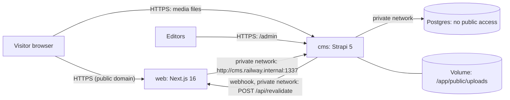
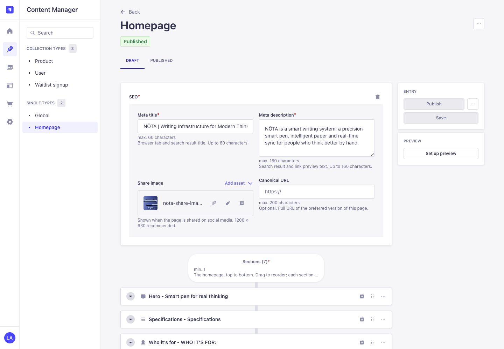
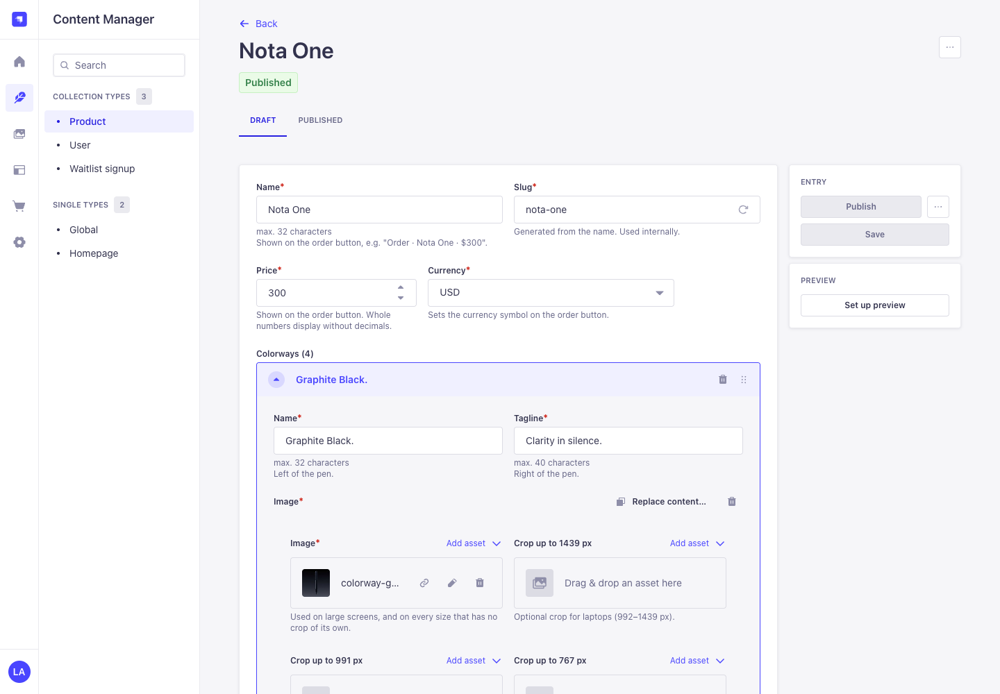
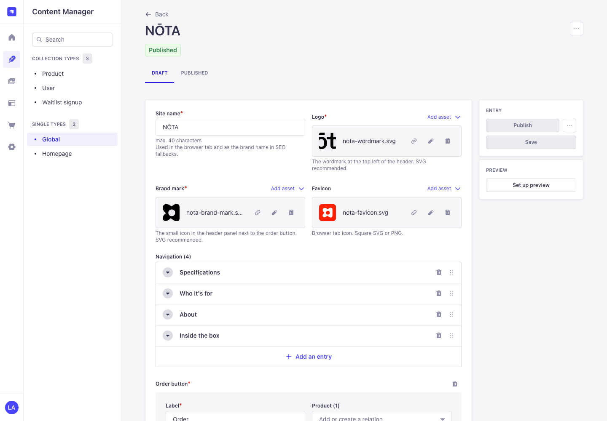
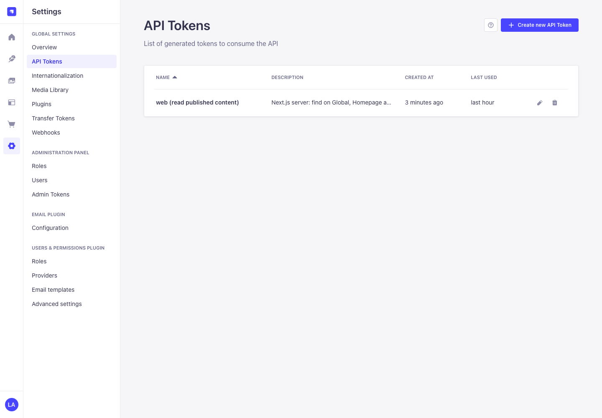
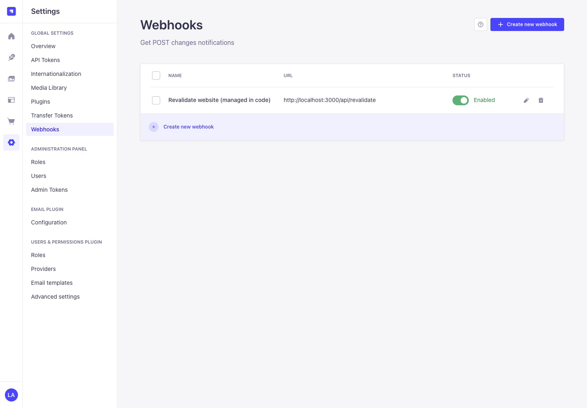

# NŌTA homepage rebuild: Next.js + Strapi on Railway

A rebuild of the homepage of [nota.uprock.pro](https://nota.uprock.pro/) for the Surge Global Senior Web Developer
assignment. Every piece of content is managed in a self-hosted Strapi CMS, and everything runs on Railway.

| | |
|---|---|
| **Live site** | https://web-production-a8a7ed35.up.railway.app |
| **Strapi admin** | https://cms-production-f797e725.up.railway.app/admin (reviewer logins are sent separately) |
| **Version** | `v1.0.0` is the submitted build; the live deploy runs `main` |

The site is `noindex` and will be taken down when the review round closes. The design belongs to its original
creators (see [Credits](#credits)).

**Contents:** [Why this framework](#why-this-framework) · [Architecture](#architecture-and-content-freshness) ·
[Run locally](#run-locally) · [Content model](#content-model) · [Railway setup](#railway-setup) ·
[Key trade-offs](#key-trade-offs) · [What I'd improve](#what-id-improve-with-more-time) ·
[AI tools used](#ai-tools-used) · [Testing, accessibility and performance](#testing-accessibility-and-performance)

**Deeper docs:** [architecture](docs/architecture.md) (caching, motion, security, form, Railway runbook) ·
[content model](docs/content-model.md) · [reference audit](docs/reference-audit.md) (what was measured and how) ·
[AI usage log](docs/ai-usage.md)

## Why this framework

The page is mostly scroll choreography wrapped around CMS content. **Next.js 16 (App Router)** handles the CMS
side well and leaves the motion side as ordinary client components:

- **Server Components fetch Strapi on the server**, so API tokens never reach the browser.
- **Tagged fetch caching with on-demand revalidation** lets a Strapi publish reach the live site on the next
  refresh, without a deploy.
- **`generateMetadata`** builds the SEO tags from Strapi.
- **A Server Action** is the form's secure proxy to Strapi: CSRF origin check, body limit, no public API route.
- **One React tree** holds both modes: static layouts for phones and tablets, and GSAP scroll scenes for large
  screens, which load only there.

Alongside it: **TypeScript (strict)**, **CSS Modules** with design tokens (the page is bespoke, so scoped CSS per
section reads better than utility classes), **GSAP + ScrollTrigger** for the pinned and scrubbed scenes, and **Zod**
for one set of rules shared by the browser, the server and the CMS data.

**Alternatives considered:**
- **Astro:** excellent for content sites, but nearly every section here needs client JavaScript, so islands buy little.
- **Nuxt:** equivalent capability; I chose the React ecosystem.
- **A plain SPA:** no server rendering, so weaker SEO metadata, tokens in the browser, and no request-time cache.

## Architecture and content freshness



**How a publish reaches the live site:**

1. `web` reads Strapi over the private network with a read-only token. Each response is cached and tagged
   (`strapi:global`, `strapi:homepage`, `strapi:product`).
2. An editor publishes. Strapi's webhook (created from env vars on every boot, visible under *Settings → Webhooks*)
   calls `web` at `/api/revalidate` with a shared secret, over the private network.
3. `web` expires the tags with `{ expire: 0 }`, so **the very next refresh shows the change**. Next's default
   profile would serve one stale page first.
4. The page renders per request, never at build time, because Railway build containers cannot reach the private
   network. Cached fetches mean most requests never touch Strapi.
5. If Strapi is down, `web` serves the last good content it holds. With nothing cached, it returns a branded error
   page with a 5xx.

The form path is in [architecture → Waitlist form](docs/architecture.md#waitlist-form-browser--server-action--strapi),
and the motion system is in [architecture → Motion](docs/architecture.md#motion-scroll-scenes).

## Repository layout

```
apps/web   Next.js 16 (App Router, TypeScript): the site
apps/cms   Strapi 5 (TypeScript, Postgres): content model, admin, media, seed
.railway/  Railway Infrastructure as Code (railway.ts)
docs/      Architecture, content model, reference audit, AI usage
```

These are two independent apps with their own lockfiles. There is no workspace hoisting, because Strapi works best
standalone.

## Run locally

**Prerequisites:** Node 24 (`.nvmrc`), npm 10+, Docker.

```bash
# 1. Database
docker compose up -d                      # Postgres 18 on localhost:5432

# 2. CMS
cd apps/cms
cp .env.example .env                      # then replace every "change-me" with a random value
npm install
npm run seed                              # all homepage content and media (~1 min the first time)
npm run develop                           # http://localhost:1337/admin → create your admin user

# 3. In the admin: Settings → API Tokens → Create new API Token, type "Custom", duration "Unlimited":
#    - read token: find on Global, Homepage and Product        → STRAPI_READ_TOKEN
#    - form token: create on Waitlist-signup (nothing else)     → STRAPI_FORM_TOKEN
#    (or locally: cd apps/cms && npm run --silent create-token -- read|form, which prints just the token)

# 4. Web (new terminal)
cd apps/web
cp .env.example .env.local                # paste the tokens into STRAPI_READ_TOKEN / STRAPI_FORM_TOKEN and use the
npm install                               # same REVALIDATE_SECRET as apps/cms/.env
npm run dev                               # http://localhost:3000
```

Publishing in Strapi now refreshes the local site immediately: the CMS calls `http://localhost:3000/api/revalidate`.

### Checks

```bash
cd apps/web && npm run lint && npm run format:check && npm run typecheck && npm test && npm run build
cd apps/cms && npm run typecheck && npm test && npm run build
```

CI runs the same steps on every push (`.github/workflows/ci.yml`), and Railway deploys `main` only after CI passes.

## Content model

All homepage content comes from Strapi: copy, images, video, links, the price, navigation, the form's copy and
messages, footer credits, alt text and SEO.

| Type | Kind | Holds |
|---|---|---|
| **Global** | Single type | Brand, navigation, order button (linked to the product), mobile menu, preloader, waitlist form copy, footer, default SEO |
| **Homepage** | Single type | Title, SEO and a **dynamic zone** of the seven section components |
| **Product** | Collection | Name, price, currency and colorways. The order button and the colorways section both read it through a **relation**, so the price is edited once. |
| **Waitlist signup** | Collection, no Draft & Publish | Email (validated, unique) and which button opened the form |

- **Sections are components in a dynamic zone** (`hero`, `specs`, `audience`, `smart-paper`, `inside-box`,
  `details`, `colorways`). Editors can reorder or hide sections without a deploy, and the page can't receive a
  section it can't render.
- **Lists are repeatable components:** spec groups, audience cards, story steps, tiles, colorways and credits. No
  rich-text blobs: the reference has no formatted paragraphs.
- **Responsive images** are one component: an image plus optional crops for each breakpoint, with required alt
  text. The reference art-directs most images per breakpoint.
- **Editor experience:** every field has help text saying where it appears, plus a placeholder, a length limit
  sized to its space, and format checks for anchors, URLs and colours. Repeatable items are titled by their
  content. Draft & Publish means saving a draft never changes the live site.
- **Access:** the Public role has no permissions, enforced on every boot. The site reads with a token that cannot
  read waitlist emails, and writes signups with a create-only token.
- **Seed:** `npm run seed` reproduces the whole page on an empty database. It is idempotent and never overwrites an
  editor's work unless asked to.

| Homepage sections (dynamic zone) | Product with colorways |
|---|---|
|  |  |

| Global | API tokens | Webhook |
|---|---|---|
|  |  |  |

Every type, component and validation rule is in [docs/content-model.md](docs/content-model.md).

## Railway setup

| Resource | Role | Public? |
|---|---|---|
| `web` | Next.js; health at `/api/health` | Yes: the site |
| `cms` | Strapi admin, API and media; health at `/_health` | Yes: admin and media URLs |
| `Postgres` | Strapi's database | **No**: private network only, no TCP proxy |
| `cms-uploads` volume | Uploads at `/app/public/uploads`; survives redeploys | n/a |

- **Config as code:** `.railway/railway.ts` (Railway Infrastructure as Code) declares the services, Postgres, the
  volume, root directories, builds, watch paths, start commands, healthchecks, restart policy, the edge cache and
  every variable.
  Railway's `railway.toml` is deprecated for new services.
- **Variables:** reference variables connect the services, for example
  `STRAPI_INTERNAL_URL = http://${{cms.RAILWAY_PRIVATE_DOMAIN}}:${{cms.PORT}}` and
  `DATABASE_URL = ${{Postgres.DATABASE_URL}}`. The webhook secret is one shared variable used by both apps. Secrets
  were set through stdin and are never committed. Tokens are server-only, and `web` validates its env at start.
- **Networking:** `web → cms` reads and the `cms → web` webhook both use `*.railway.internal`; only `web` and `cms`
  have public domains.
- **Region:** all three run in Singapore (`asia-southeast1`), close to the reviewers. They moved from US West on
  20 Nov, the database last: while Postgres was still in the US, every Strapi query crossed the Pacific and opening
  the homepage in the admin took 18 s instead of 0.2 s. The database must always share the CMS's region.
- **Edge cache:** Railway's CDN is on for `web` and `cms`. It follows `Cache-Control`, so it keeps only hashed
  static files and uploads; pages, the admin and the API always reach the services.
- **Deploys:** GitHub autodeploy from `main` after CI passes, one root directory per service, and watch paths, so
  a web-only commit never redeploys the CMS. Healthchecks gate the switch to a new deployment.

The full variable table, networking notes and a one-time setup runbook are in
[docs/architecture.md](docs/architecture.md#railway-configuration-as-code).

## Key trade-offs

- **Volume, not object storage, for uploads.** It's simple and survives redeploys, but it pins `cms` to one replica
  with a few seconds of downtime per deploy. S3 or R2 with Strapi's provider is the scale-out path.
- **Request-time render with a tagged cache, not a static build.** The build cannot reach Strapi on Railway, and
  `expire: 0` makes the first refresh after publishing fresh. The cost is a server render per request, which is
  cheap because the CMS data is cached.
- **Honeypot plus a per-IP rate limit, not a captcha.** There's no third-party script, cookie or friction. The
  limiter is in memory, which is right for one instance; it would move to Redis if `web` scaled out. Duplicate
  addresses are shown as success, so the form never reveals who has signed up.
- **Motion timing lives in code, content lives in the CMS.** Scene lengths, eases and offsets were measured on the
  reference and are design behaviour, not editorial content. Editors change words, media, order and visibility, not
  choreography.
- **Two layout modes.** Large screens without a reduced-motion preference get the pinned, scrubbed scenes. Phones,
  tablets and reduced-motion visitors get static layouts, as on the reference. Unlike the reference, we honour
  reduced motion.
- **What stays in code (the R4 exceptions):** functional icons (burger, close, chevrons, the colorways dot), the
  header's light or dark theme per section, the per-breakpoint scaling, scroll-scene timing, and the copy of the
  error and 404 pages, which must work when the CMS is down.
- **The hero "Lottie" is drawn on a canvas.** The file is 75 full-frame images with static transforms, so a canvas
  is lighter than a Lottie runtime and scrubs exactly.
- **Wheel easing is ~85 lines of our own code, not Lenis.** It matches the reference's measured easing without a new
  dependency.
- **Reference greys over AA contrast.** Three greys from the design are below AA for their size; they were kept for
  fidelity (see [Testing, accessibility and performance](#testing-accessibility-and-performance)).
- **`noindex` is hard-coded** (meta tag, `X-Robots-Tag` and `robots.txt`), so no CMS field or env var can switch it
  off.
- **Known deviations:**
  - The shorter spec copy the reference shows at 992–1439px is not reproduced, because there is one CMS string per
    bullet.
  - One details tile has separate art at ≥1920px on the reference; ours shows the 1440 art.
  - On wide, short screens, scenes before "Who it's for" start up to ~200px of scroll later than on the reference
    (within ~15px at 1440×900).

## What I'd improve with more time

- **Visual regression tests:** Playwright screenshots at each breakpoint and key scroll positions, compared in CI
  against approved baselines.
- **End-to-end tests in CI**, with a Postgres service and the seed; today they run locally.
- **Strapi Preview with Next.js Draft Mode**, so editors can see a draft on the real page before publishing.
- **Object storage** for media, so `cms` can run more than one replica (the uploads volume pins it to one).
- **Calibrate scroll timing at more aspect ratios**: it was tuned at 1440×900 and checked at others.
- **Real-device testing:** iOS Safari and Android Chrome on hardware, not only emulation.
- **Lighthouse CI budgets**, so performance can't regress unnoticed.

## AI tools used

**Claude Code (Claude Opus 5.5)** was my pair programmer through every phase. I set the plan, the phase gates and
the rules, reviewed each phase before merging, and made the product decisions. Every entry, with what I verified
or changed, is in [docs/ai-usage.md](docs/ai-usage.md).

| Used for | How the output was checked or changed |
|---|---|
| **Reference audit:** throwaway Playwright scripts that measured the *rendered* reference (geometry, timing, colours) | No reference HTML, CSS or JS was saved or reused, only measurements and visible copy. I reviewed the contact sheets. |
| **Code:** both apps, the content model and seed, the scroll scenes, the form, CI and the Railway IaC | Framework APIs were checked against the installed versions' docs and source, not memory. Every phase passed lint, types, tests and build, and was compared side by side with the reference. |
| **Debugging and hardening:** CSP, accessibility (axe), cross-browser runs, performance | Real failures drove the fixes (a WebKit-only CSP issue, the video tile covering the cards, the missing wheel easing). I reported the last two from my own screen recordings. |
| **Docs:** this README and `docs/` | I edited them for accuracy and tone. |

**Decisions that were mine:**
- the Railway account and every billable or destructive step;
- all production secrets and tokens, handed to the CLI from my clipboard and never pasted into the chat;
- Surge's clearance to reuse the videos and Lottie;
- the colour-picker plugin and the wordmark file;
- keeping the reference greys over AA contrast.

Commits carry no AI trailer by my choice; AI use is disclosed here and in the log.

## Testing, accessibility and performance

- **Unit tests** (Vitest): content mappers, env and revalidation, the waitlist rules, rate limiter and Strapi
  response handling, the CSP builder, the scramble, image-sequence and wheel-easing helpers. The CMS has tests for
  the editor copy (every field described) and the webhook bootstrap.
- **End-to-end** (Playwright, below): the waitlist form on desktop and a phone; on request also Firefox,
  desktop Safari (WebKit) and an iPhone (`E2E_ALL_BROWSERS=1`, after `npx playwright install webkit firefox`).
- **Accessibility:** axe (WCAG 2.1 A/AA and best practices) was run on desktop (cinematic and reduced motion), on a
  phone with the menu open, and with the form open. The only finding is colour contrast on the reference's own
  greys (below); there are no other violations.
  - **Keyboard:** skip link, focus trap and return in the dialogs, visible focus, and swipe carousels reachable and
    scrollable with the arrow keys.
  - **Reduced motion:** static layouts, no preloader and no autoplay.
- **Reference greys kept on purpose:** three of the design's greys are below AA contrast for their text size:
  - #666 on black (footer credits, 3.65:1);
  - white at 40% on black (the "Who it's for" eyebrow and the order button's product label);
  - #999 on white (the large grey "Inside", 2.84:1).

  The nearest AA values (#767676, white 47%, #949494) were tried, and the reference's colours were kept for
  fidelity. Switching back takes a few lines of CSS.
- **Performance:**
  - Lighthouse mobile is ~93–98 (CLS 0, TBT ~0).
  - Phones never download GSAP, the scenes or the 1.8 MB hero sequence. Videos load only within a screen of view,
    only Latin fonts are preloaded, and the hero image has high fetch priority.
  - Simulated slow-4G LCP was about 2.5–3 s, mostly the round trip to Railway's US region; observed LCP was
    ~1.2 s. These figures and the Lighthouse scores above predate the move to Singapore, which is nearer the
    reviewers, and weren't re-measured.
  - On desktop the wheel glides with the reference's measured easing. A scripted scroll through the whole page
    holds 60 fps with no long frames, as the reference does.
- **Browsers:** the full scroll story was checked in Chrome, Firefox and WebKit (Safari's engine), and the phone
  layout in an iPhone emulation.

### End-to-end tests

Playwright drives the waitlist form against the running site and CMS (desktop and phone):
- empty and invalid input;
- success, with the entry stored in Strapi;
- a repeat address shown as success, without a second entry;
- the honeypot.

They need both servers running and an `E2E_STRAPI_TOKEN` (find + delete on Waitlist-signup) in
`apps/web/.env.local`, so they can check and then delete what they created.

```bash
cd apps/cms && npm run --silent create-token -- e2e   # paste into apps/web/.env.local as E2E_STRAPI_TOKEN
cd apps/web && npm run test:e2e                       # uses the installed Chrome
```

## Credits

The design, copy, photography, videos and hero animation belong to the creators of the original NŌTA site
([nota.uprock.pro](https://nota.uprock.pro/), made in Taptop). They are reused here only for this assignment, and
Surge cleared the reuse of the videos and animation. The code is written from scratch: the reference was observed
and measured, never copied (see [docs/reference-audit.md](docs/reference-audit.md)). The site is `noindex` and
will be taken down when the review round closes.
