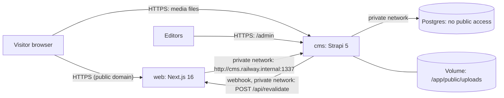
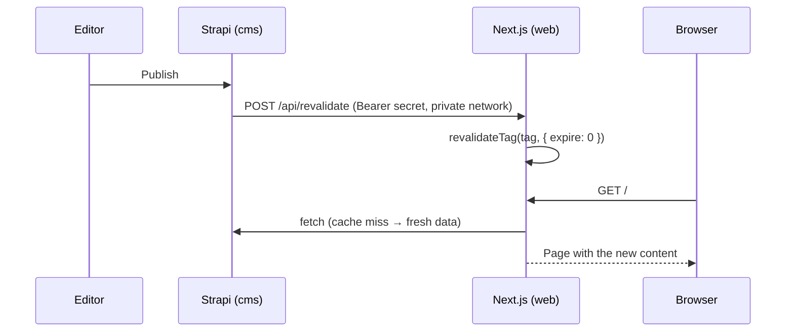
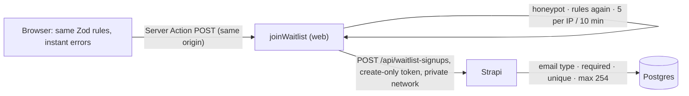

# Architecture

Two independent apps in one repository, deployed as three Railway resources plus a volume.



| Resource | What it does | Public? |
|---|---|---|
| `web` (Next.js) | Renders the homepage per request from cached CMS data; receives the revalidation webhook; health at `/api/health` | Yes (the site) |
| `cms` (Strapi) | Content model, admin, REST API, media; health at `/_health` | Yes (admin + media URLs) |
| `Postgres` | Strapi's database | **No**: private network only |
| `cms-uploads` volume | Uploaded media at `/app/public/uploads`; survives redeploys | n/a |

## Content freshness (publish → live without a deploy)



- `web` fetches Strapi with a **read-only token** using `fetch(..., { cache: 'force-cache', next: { tags } })`.
  Every request is tagged `strapi` plus its own tag (`strapi:global`, `strapi:homepage`, `strapi:product`).
- The page uses `export const revalidate = 0`: it renders **per request, never at build**, because Railway
  build containers cannot reach the private network. Cached fetches mean most requests never touch Strapi.
- The webhook expires tags with `{ expire: 0 }` (no stale window), so **the first refresh after publishing
  shows the change**. The default `'max'` profile would serve one stale response first.
- The webhook is created/updated from env vars on every Strapi boot (`apps/cms/src/bootstrap/revalidate-webhook.ts`)
  and is visible under *Settings → Webhooks*. It fires on publish/unpublish/delete of Draft & Publish content
  types and on media update/delete. Saving a draft does not change the live site, so it does not fire.
  Waitlist signups (Draft & Publish off) never purge the cache.
- If Strapi is unreachable, `web` serves the last good payload it holds in memory. With no copy at all it renders
  an error page with a 5xx.
- Next.js 16's Cache Components are switched off: they prerender a static shell at build time, which our build
  cannot do without the CMS.

## Motion (scroll scenes)

Large screens without a reduced-motion preference get the reference's "cinematic" mode; phones, tablets
and reduced-motion visitors keep the static layouts. One media query (`lib/animation/media.ts`) gates
both the CSS and the JavaScript, so layout never waits for JS.

- **Pinning is CSS, not JS.** Each scene is a tall wrapper (`height: (--scene + 1) × 100vh`) holding a
  `position: sticky` 100vh stage. Where one stage must stay frozen under the next (hero → specs), the
  next section starts higher with a negative margin. Where a section slides in under a stage that is
  turning the same colour (black bands, white circle), it stays invisible until it pins, so the
  hand-over is seamless.
- **Scrubbing is GSAP.** `components/motion/Scene.tsx` wraps a server-rendered section and, the first time
  cinematic mode applies, imports `lib/animation/run-scene.ts`, which runs that section's scene
  (`lib/animation/scenes/*`) inside `gsap.matchMedia`. Phones and reduced-motion visitors never download
  GSAP or the scenes. A scene's
  timeline is measured in viewport heights of scroll (1 = 100vh), and its length is read from the same
  `--scene` CSS variable that sizes the wrapper, so CSS and JS cannot drift apart. Positions and eases
  are named constants measured on the reference (docs/reference-audit.md §1.3). Leaving cinematic
  mode (resize, OS setting, unmount, hot reload) reverts every tween and ScrollTrigger.
- **Hero sequence.** The hero "Lottie" is 75 full-frame WebP images with static transforms, so a
  canvas draws the current frame instead of shipping a Lottie runtime. It is downloaded only in
  cinematic mode; until the frames are decoded the server-rendered first frame shows.
- **Preloader** (`components/motion/Preloader.tsx`) follows real progress (fonts and the sequence), never
  counts faster than the reference's 1.2s, and gives up after 6s; CSS fades it out after 6s even if the
  script never runs. When it ends, the header fades in, the nav labels scramble once, and the hero heading
  reveals letter by letter through random stand-ins (`scrambleIn` in `lib/animation/scramble.ts`). The real
  text is never split: it turns transparent while an aria-hidden overlay draws each letter at the position
  the browser measured for it, so kerning and the accessible name are untouched and nothing shifts when the
  overlay goes (pixel-identical in Chrome, Firefox and WebKit).
- **Header**: hides on scroll down past the hero sequence, shows on any scroll up, and takes its colours
  from the section under it (`data-header-theme`, found by hit-testing so overlapping stages work).
- **Anchors**: in cinematic mode, in-page links jump to a set point inside the target scene
  (`data-anchor-offset`), as the reference does; elsewhere the browser smooth-scrolls.
- **Phone and tablet sliders** loop both ways, as on the reference. The smart-paper steps swipe natively
  (scroll-snap), with a copy of the last and first slide at the ends; resting on a copy jumps to the slide it
  shows (`components/ui/carousel.ts`). The colorways stack instead, and a swipe cross-fades them, following
  the finger and finishing in 500 ms (`components/ui/fade-carousel.ts`), with vertical swipes left to the page.
- **Wheel easing** (`lib/animation/smooth-scroll.ts`): in cinematic mode each wheel step moves a target
  and the page glides to it (exponential, ~167 ms time constant, measured on the reference, which uses
  Lenis). Without it a mouse wheel moves the page in ~100px jumps and the scrubbed scenes jump with it.
  It is a few dozen lines instead of a dependency. Only the wheel is eased: keyboard, scrollbar, touch,
  anchors, open dialogs and nested scrollers stay native, and ScrollTrigger is updated in the same frame
  as each step.
- **Per-frame cost** while scrolling stays small: the hero canvas repaints only when its frame changes and
  has no more pixels than the source frames, the carousel progress touches the DOM only when the step
  changes, and the header's colour hit-test runs about ten times a second.

## Security headers

- **Content-Security-Policy** (`src/proxy.ts`): a fresh nonce per request; Next.js puts it on its own
  scripts, and `'strict-dynamic'` lets those load the on-demand chunks, so no other script can run.
  Images, video and the hero sequence may come from Strapi's public origin only; `object-src 'none'`,
  `base-uri` and `form-action` are `'self'`. Styles allow inline because React renders a few `style`
  attributes, which nonces cannot cover. Pages that use nonces must render per request; the homepage
  already does, and the 404 page opts in with `connection()`.
- **Static headers** (`next.config.ts`): `X-Robots-Tag: noindex`, HSTS, `nosniff`, `Referrer-Policy`,
  `X-Frame-Options`, `Permissions-Policy`.
- **Uploads** (`apps/cms/src/middlewares/upload-headers.ts`): a sandboxing CSP on every file under
  `/uploads`, so an uploaded SVG cannot run script on the CMS domain.

## Waitlist form (browser → Server Action → Strapi)



- **One set of rules** (`lib/waitlist/schema.ts`) runs in the browser for instant feedback and again in the
  Server Action; Strapi enforces them a third time. Addresses are trimmed and lower-cased, so case
  variants are one signup.
- **The Server Action** (`app/actions/waitlist.ts`) gets Next.js's CSRF origin check and 1 MB body limit for
  free, then adds a honeypot field (bots get a quiet "success", nothing is stored), validation, and a
  per-IP limit (in memory: one web instance; a shared store such as Redis if it ever scales out).
- **The create-only token** can do one thing: create waitlist entries. It cannot read them, and the Public
  role has no permissions at all, so the list is visible only in the admin.
- **What the visitor sees** is success or a generic error. An address already on the list is reported as
  success (Strapi's unique-email 400 is recognised), so the form never reveals who has signed up; Strapi's
  details go to the server log without the address.
- Trade-off: the reference uses a captcha. A honeypot plus rate limit adds no friction or third-party
  script; a captcha (e.g. Turnstile) is the upgrade if spam ever gets past it.

## Railway configuration as code

Railway's `railway.toml` (Config as Code) is deprecated and cannot be used by new services, so the whole
project is declared in **`.railway/railway.ts`** (Railway Infrastructure as Code): services, Postgres, the volume
and its mount path, root directories, Railpack builds, watch paths, start commands, healthchecks, restart policy
and every variable, including reference variables. It is applied with the Railway CLI (`railway config plan` /
`apply`); deploys themselves come from GitHub autodeploy on `main`.

### Variables

| Service | Variable | Value | Why |
|---|---|---|---|
| cms | `HOST` / `PORT` | `::` / `1337` | IPv6 + IPv4 for private networking; explicit PORT so `web` can reference it |
| cms | `PUBLIC_URL` | `https://${{RAILWAY_PUBLIC_DOMAIN}}` | Admin and absolute URLs |
| cms | `TRUST_PROXY` | `true` | Railway terminates TLS; trust `X-Forwarded-*` |
| cms | `DATABASE_URL` | `${{Postgres.DATABASE_URL}}` | Private connection string |
| cms | `CORS_ORIGINS` | `https://${{web.RAILWAY_PUBLIC_DOMAIN}}` | Only the site's origin |
| cms | `WEB_REVALIDATE_URL` | `http://${{web.RAILWAY_PRIVATE_DOMAIN}}:${{web.PORT}}/api/revalidate` | Webhook over the private network |
| cms | `APP_KEYS`, `API_TOKEN_SALT`, `ADMIN_JWT_SECRET`, `TRANSFER_TOKEN_SALT`, `JWT_SECRET`, `ENCRYPTION_KEY` | secret, `preserve()` | Generated locally, set once, never committed |
| both | `REVALIDATE_SECRET` | `${{shared.REVALIDATE_SECRET}}` | One shared secret, two services |
| web | `PORT` | `3000` | Explicit so `cms` can reference it |
| web | `STRAPI_INTERNAL_URL` | `http://${{cms.RAILWAY_PRIVATE_DOMAIN}}:${{cms.PORT}}` | Server-side reads over the private network |
| web | `STRAPI_PUBLIC_URL` | `https://${{cms.RAILWAY_PUBLIC_DOMAIN}}` | Media URLs for browsers, `next/image` allow-list |
| web | `SITE_URL` | `https://${{RAILWAY_PUBLIC_DOMAIN}}` | Canonical URLs |
| web | `STRAPI_READ_TOKEN` / `STRAPI_FORM_TOKEN` | secret, `preserve()` | Read-only / create-only Strapi API tokens |

`web` validates its env with Zod at server start (`src/instrumentation.ts`); a misconfigured deploy fails its
healthcheck and Railway keeps the previous deployment live.

### Networking

- Public domains: `web` and `cms` only. Postgres has **no TCP proxy** (checked after apply).
- `web → cms` and `cms → web` use `*.railway.internal` over plain `http://` on the service port.
- Private networking exists only at runtime, never during builds.

### Volume

- `cms-uploads` mounted at `/app/public/uploads` (Railpack puts the app in `/app`).
- A service with a volume runs as **one replica** and has a few seconds of downtime on redeploy. Object
  storage (S3/R2 + Strapi's S3 provider) is the scale-out alternative.

### Deploys

- GitHub autodeploy from `main`, one root directory per service (`apps/web`, `apps/cms`).
- Watch paths (`/apps/web/**`, `/apps/cms/**`) mean a web-only commit never redeploys the CMS and vice versa.
- Healthchecks gate traffic switching: `/api/health` (web), `/_health` (cms).

## One-time setup (runbook)

Run with Railway CLI 5.74 (IaC needs ≥ 5.42.1). Secrets are piped through `--stdin`, so they never appear in
shell history, process lists or logs.

```bash
# 1. Authenticate and link (one environment: production)
railway login
railway link --project <project> --environment production
(cd .railway && npm ci)                     # the SDK the CLI uses to evaluate railway.ts

# 2. Shared secret: the CLI cannot create shared variables, so add REVALIDATE_SECRET in
#    Project Settings → Shared Variables, then deploy the staged change. Value:
node -e "process.stdout.write(require('crypto').randomBytes(32).toString('hex'))" | pbcopy

# 3. Create/update every resource from .railway/railway.ts
railway config plan                          # review the diff
railway config apply --yes                   # add --confirm-destructive only for an approved deletion

# 3b. Autodeploy. Railway only hears about pushes if its GitHub App can see the repo:
#     install https://github.com/apps/railway-app for this repository first. Then create a
#     trigger per service; checkSuites = "Wait for CI", so main deploys only after Actions passes.
railway api 'mutation($i: DeploymentTriggerCreateInput!){ deploymentTriggerCreate(input:$i){ id } }' \
  --variables '{"i":{"provider":"github","repository":"<owner>/<repo>","branch":"main","checkSuites":true,
    "rootDirectory":"apps/cms","projectId":"<project>","environmentId":"<environment>","serviceId":"<cms>"}}'
#     (repeat for web with rootDirectory "apps/web")
railway config plan                          # must report "already up to date" (no drift)

# 4. Public domains BEFORE the first build: both apps read the other's domain at build time
railway domain --service cms --port 1337
railway domain --service web --port 3000

# 5. Strapi secrets (APP_KEYS takes 4 comma-separated values)
node -e "const c=require('crypto');process.stdout.write([1,2,3,4].map(()=>c.randomBytes(16).toString('base64')).join(','))" \
  | railway variable set APP_KEYS --stdin --service cms --skip-deploys
for k in API_TOKEN_SALT ADMIN_JWT_SECRET TRANSFER_TOKEN_SALT JWT_SECRET; do
  node -e "process.stdout.write(require('crypto').randomBytes(16).toString('base64'))" \
    | railway variable set $k --stdin --service cms --skip-deploys
done
node -e "process.stdout.write(require('crypto').randomBytes(32).toString('base64'))" \
  | railway variable set ENCRYPTION_KEY --stdin --service cms

# 6. After cms is healthy: create the first admin at /admin, then Settings → API Tokens →
#    Custom, unlimited, permissions: find on Global, Homepage, Product (it cannot read waitlist
#    emails). Delete Strapi's auto-created "Full Access" and "Read Only" tokens. Pipe the key in:
pbpaste | tr -d '\n' | railway variable set STRAPI_READ_TOKEN --stdin --service web --skip-deploys
railway redeploy --service web --from-source --yes

# 7. Waitlist form token: Settings → API Tokens → Custom, unlimited, permissions: Waitlist-signup →
#    create (nothing else). Pipe the key in the same way:
pbpaste | tr -d '\n' | railway variable set STRAPI_FORM_TOKEN --stdin --service web
```

### Seeding production

The seed runs inside the live `cms` container (it needs the volume and the private database):

```bash
ssh-keygen -t ed25519 -N "" -f ~/.ssh/railway_ed25519        # a key used only for Railway
railway ssh keys add --key ~/.ssh/railway_ed25519.pub
railway ssh config --service cms --dry-run                   # shows the user@ssh.railway.com target
ssh -i ~/.ssh/railway_ed25519 -o StrictHostKeyChecking=accept-new <user>@ssh.railway.com \
  'cd /app && node scripts/seed.js --no-compile'             # add --overwrite to replace content
```

**Verify:** `curl -I` the site shows `X-Robots-Tag: noindex`; the Postgres service has no domain, TCP proxy or
`DATABASE_PUBLIC_URL`; a publish appears on the next refresh; an uploaded file returns the same SHA-256 before and
after `railway redeploy --service cms --yes`.

**Lessons from the first deploy:** a build that runs before the other service's domain exists sees `https://` for
`${{cms.RAILWAY_PUBLIC_DOMAIN}}`, so generate domains first (step 4). A failed build has no image, so retry it with
`--from-source`. Builds worked without the Railway GitHub App (the repo is public), but pushes deployed nothing:
Railway refused to create triggers ("no one in the project has access") until the app was installed for the repo
(step 3b). A deploy of a commit touching only `apps/web/**` marked `cms` as SKIPPED, confirming the watch paths.
Strapi 5 also grants the Public role self-registration by default; the CMS now removes every Public permission on
boot. Railway's Postgres template runs `postgres-ssl:18`.

## Local development

See the README: `docker compose up -d` (Postgres), then `npm run develop` in `apps/cms` and `npm run dev` in
`apps/web`.
