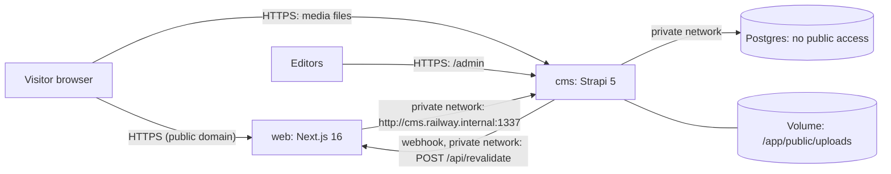
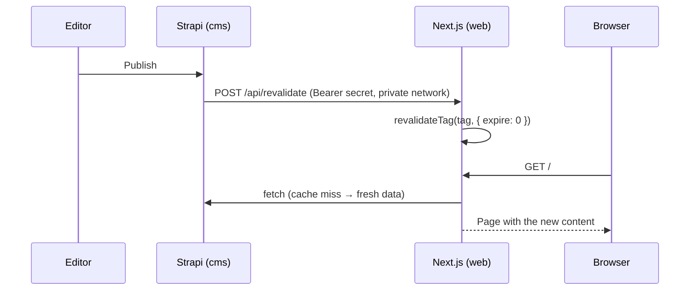

# Architecture

Two independent apps in one repository, deployed as three Railway resources plus a volume.

| Resource | What it does | Public? |
|---|---|---|
| `web` (Next.js) | Renders the homepage per request from cached CMS data; receives the revalidation webhook; health at `/api/health` | Yes (the site) |
| `cms` (Strapi) | Content model, admin, REST API, media; health at `/_health` | Yes (admin + media URLs) |
| `Postgres` | Strapi's database | **No**: private network only |
| `cms-uploads` volume | Uploaded media at `/app/public/uploads`; survives redeploys | n/a |

## Content freshness (publish → live without a deploy)

- `web` fetches Strapi with a **read-only token** using `fetch(..., { cache: 'force-cache', next: { tags } })`.
  Every request is tagged `strapi` plus its own tag (`strapi:global`, `strapi:homepage`, `strapi:product`).
- The page uses `export const revalidate = 0`: it renders **per request, never at build**, because Railway
  build containers cannot reach the private network. Cached fetches mean most requests never touch Strapi.
- The webhook expires tags with `{ expire: 0 }` (no stale window), so **the first refresh after publishing
  shows the change**. The default `'max'` profile would serve one stale response first.
- The webhook is created/updated from env vars on every Strapi boot (`apps/cms/src/bootstrap/revalidate-webhook.ts`)
  and is visible under *Settings → Webhooks*. It fires on publish/unpublish/delete of Draft & Publish content
  types and on media update/delete. Saving a draft does not change the live site, so it does not fire.
  Waitlist signups (Draft & Publish off) never purge the cache.
- If Strapi is unreachable, `web` serves the last good payload it holds in memory. With no copy at all it renders
  an error page with a 5xx.
- Next.js 16's Cache Components are switched off: they prerender a static shell at build time, which our build
  cannot do without the CMS.

## Railway configuration as code

Railway's `railway.toml` (Config as Code) is deprecated and cannot be used by new services, so the whole
project is declared in **`.railway/railway.ts`** (Railway Infrastructure as Code): services, Postgres, the volume
and its mount path, root directories, Railpack builds, watch paths, start commands, healthchecks, restart policy
and every variable, including reference variables. It is applied with the Railway CLI (`railway config plan` /
`apply`); deploys themselves come from GitHub autodeploy on `main`.

### Variables

| Service | Variable | Value | Why |
|---|---|---|---|
| cms | `HOST` / `PORT` | `::` / `1337` | IPv6 + IPv4 for private networking; explicit PORT so `web` can reference it |
| cms | `PUBLIC_URL` | `https://${{RAILWAY_PUBLIC_DOMAIN}}` | Admin and absolute URLs |
| cms | `TRUST_PROXY` | `true` | Railway terminates TLS; trust `X-Forwarded-*` |
| cms | `DATABASE_URL` | `${{Postgres.DATABASE_URL}}` | Private connection string |
| cms | `CORS_ORIGINS` | `https://${{web.RAILWAY_PUBLIC_DOMAIN}}` | Only the site's origin |
| cms | `WEB_REVALIDATE_URL` | `http://${{web.RAILWAY_PRIVATE_DOMAIN}}:${{web.PORT}}/api/revalidate` | Webhook over the private network |
| cms | `APP_KEYS`, `API_TOKEN_SALT`, `ADMIN_JWT_SECRET`, `TRANSFER_TOKEN_SALT`, `JWT_SECRET`, `ENCRYPTION_KEY` | secret, `preserve()` | Generated locally, set once, never committed |
| both | `REVALIDATE_SECRET` | `${{shared.REVALIDATE_SECRET}}` | One shared secret, two services |
| web | `PORT` | `3000` | Explicit so `cms` can reference it |
| web | `STRAPI_INTERNAL_URL` | `http://${{cms.RAILWAY_PRIVATE_DOMAIN}}:${{cms.PORT}}` | Server-side reads over the private network |
| web | `STRAPI_PUBLIC_URL` | `https://${{cms.RAILWAY_PUBLIC_DOMAIN}}` | Media URLs for browsers, `next/image` allow-list |
| web | `SITE_URL` | `https://${{RAILWAY_PUBLIC_DOMAIN}}` | Canonical URLs |
| web | `STRAPI_READ_TOKEN` / `STRAPI_FORM_TOKEN` | secret, `preserve()` | Read-only / create-only Strapi API tokens |

`web` validates its env with Zod at server start (`src/instrumentation.ts`); a misconfigured deploy fails its
healthcheck and Railway keeps the previous deployment live.

### Networking

- Public domains: `web` and `cms` only. Postgres has **no TCP proxy** (checked after apply).
- `web → cms` and `cms → web` use `*.railway.internal` over plain `http://` on the service port.
- Private networking exists only at runtime, never during builds.

### Volume

- `cms-uploads` mounted at `/app/public/uploads` (Railpack puts the app in `/app`).
- A service with a volume runs as **one replica** and has a few seconds of downtime on redeploy. Object
  storage (S3/R2 + Strapi's S3 provider) is the scale-out alternative.

### Deploys

- GitHub autodeploy from `main`, one root directory per service (`apps/web`, `apps/cms`).
- Watch paths (`/apps/web/**`, `/apps/cms/**`) mean a web-only commit never redeploys the CMS and vice versa.
- Healthchecks gate traffic switching: `/api/health` (web), `/_health` (cms).

## One-time setup (runbook)

> CLI flags below are checked against the installed Railway CLI before running.

1. `railway login`, then from the repo root `railway link` (or create the project).
2. Shared variable `REVALIDATE_SECRET` (Project → Settings → Shared Variables), value from
   `node -e "console.log(require('crypto').randomBytes(32).toString('hex'))"`.
3. `railway config plan`, review, then `railway config apply`.
4. CMS secrets: set `APP_KEYS` (4 comma-separated values) and the five salts/secrets on `cms` with
   `railway variables`, each from `node -e "console.log(require('crypto').randomBytes(16).toString('base64'))"`.
5. Generate public domains for `cms` and `web`. Confirm Postgres has no public networking.
6. After `cms` is healthy: open `/admin`, create the first admin, create a **read-only** API token, and set it as
   `STRAPI_READ_TOKEN` on `web`.
7. Verify: `curl -I` the site (`X-Robots-Tag: noindex`), publish a change and refresh, upload an image and
   redeploy `cms` (the image still loads).

## Local development

See the README: `docker compose up -d` (Postgres), then `npm run develop` in `apps/cms` and `npm run dev` in
`apps/web`.
