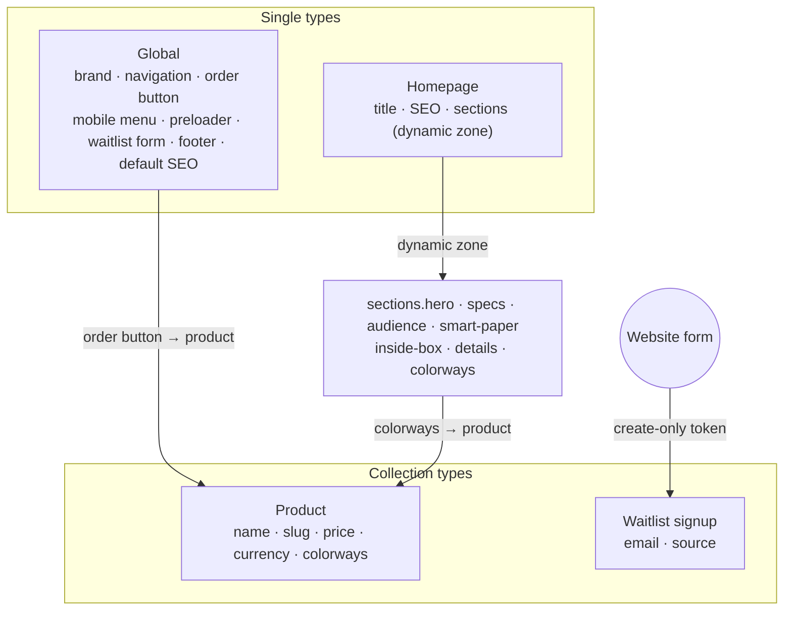
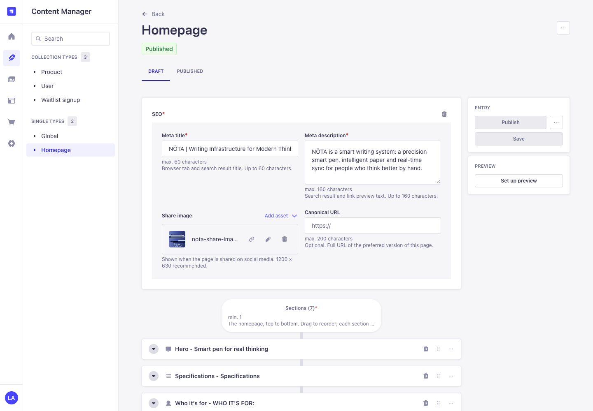
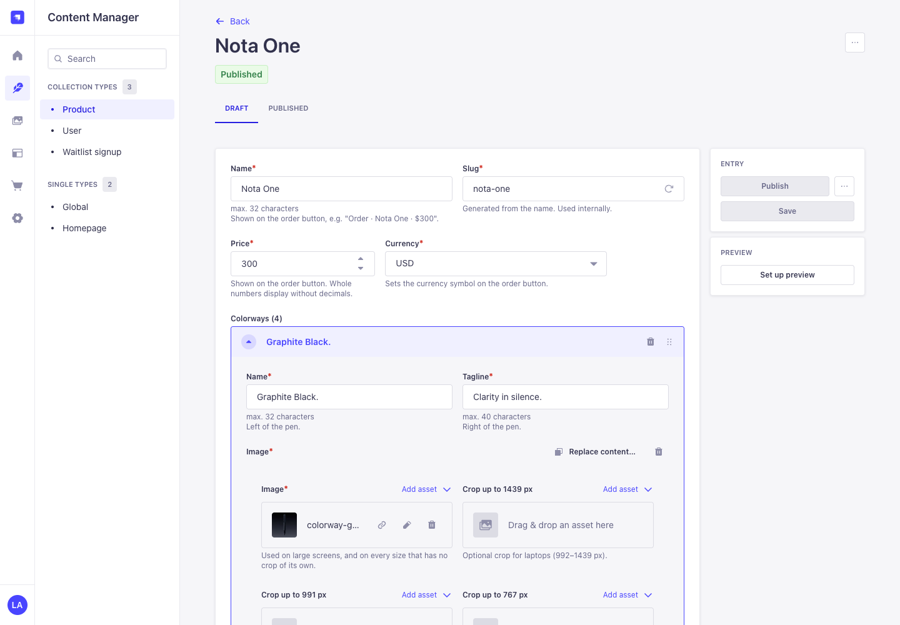
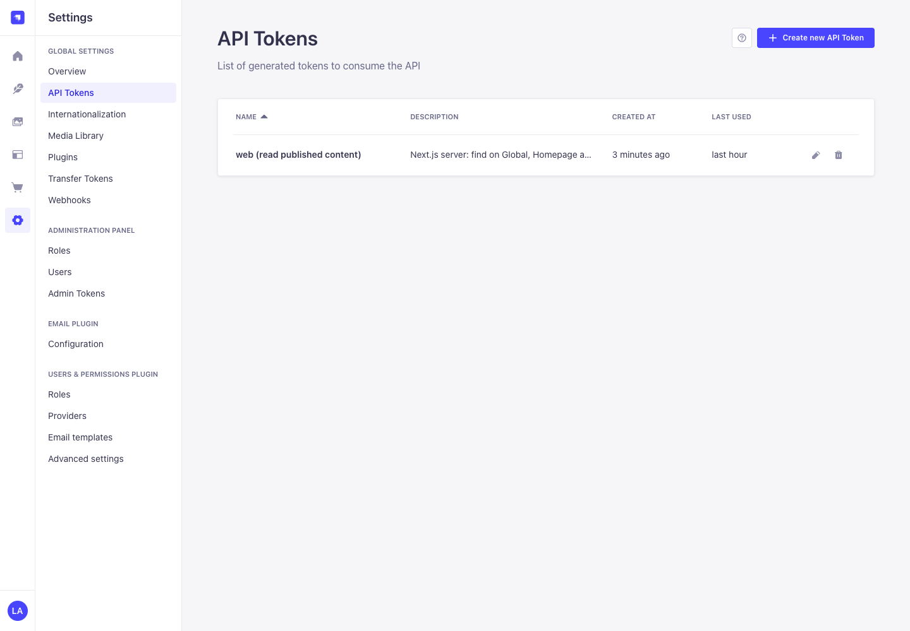

# Content model

Everything on the homepage (copy, images, video, links, pricing, navigation, SEO) comes from Strapi. Schemas live
in code (`apps/cms/src/api/**/schema.json`, `apps/cms/src/components/**.json`), so the model is versioned and
reviewed like any other change. Production's Content-Type Builder is read-only by design.

## Why it is shaped this way

| Choice | Reason |
|---|---|
| **Global** single type | Header, menu, modal and footer appear on every page; one place to edit them. |
| **Homepage** single type with a **dynamic zone** | Editors can reorder, hide (`isHidden`) or add sections without a deploy, while each section keeps its own fields and layout. Only the seven section components are allowed, so the page can't receive content it can't render. |
| **Product** as a collection type, linked by **relation** | Pricing is real data, not copy. The order button ("Order · Nota One · $300") and the colorways section both read the same product, so changing the price or adding a colour happens once. |
| **Waitlist signup** collection, Draft & Publish **off** | Form entries are records, not content. Draft & Publish off also keeps them out of the revalidation webhook. |
| **Components** for anything repeated or grouped | Spec groups, audience cards, story steps, tiles, colorways, credits and team names are lists of small typed items, so there are no rich-text blobs. Rich text is not used anywhere: the reference has no formatted paragraphs. |
| **`shared.responsive-image`** | The reference art-directs most images per breakpoint (different crops for laptop, tablet and phones). One image plus optional crops (`max1439`, `max991`, `max767`, `max479`), each falling back to the next larger, renders as a `<picture>`. Alt text is required on the component, so every usage is described. |
| Multi-line headings as plain `text` | A newline is the desktop line break; phones wrap naturally (the story-step headlines keep their first break on phones, as on the reference). Editors control breaks without markup. |
| **What stays in code** | Scroll-scene timing and easing, transitions (columns, silhouette, circle reveal, blinds), the header's light/dark theme per section, functional icons (burger, close, chevrons, the colorways progress dot), and the per-breakpoint scaling. These are design behaviour, not editorial content. |

## Types and components

**Global** (single, Draft & Publish): `siteName`, `logo`, `brandMark`, `favicon` (SVG allowed), `navigation`
(1–6 × nav link), `orderCta` (label + product), `mobileMenu` (image), `preloader` (enabled), `waitlistModal`, `footer`,
`defaultSeo`.

**Homepage** (single, Draft & Publish): `title` (admin only), `seo`, `sections` (dynamic zone, min 1).

**Product** (collection, Draft & Publish): `name` (unique), `slug` (uid), `price` (decimal ≥ 0), `currency` (USD/EUR/GBP),
`colorways` (0–8).

**Waitlist signup** (collection, no Draft & Publish): `email` (email, required, unique, ≤254), `source` (`header-cta` /
`mobile-menu-cta`).

| Section component | Fields |
|---|---|
| `sections.hero` | heading, sequence (Lottie JSON, large screens), image (static fallback + tablet/phone pen) |
| `sections.specs` | headingMuted, heading, penImage, groups (1–3 × title + 1–6 lines) |
| `sections.audience` | statement, eyebrow, intro (1–3 paragraphs), cards (1–4 × title + body), video |
| `sections.smart-paper` | headingMuted, heading, steps (2–6 × headline, card title, card text, image) |
| `sections.inside-box` | headingMuted, heading, kitTitle, kitBody, kitImage, statement, items (1–2 × name, description, image) |
| `sections.details` | tiles (exactly 6 × optional label, image and/or looping video) |
| `sections.colorways` | headingStart, headingEnd, introImage, product (its colorways are shown) |

Every section also has `anchorId` (lowercase-hyphenated, what navigation links scroll to) and `isHidden`.

Shared and element components: `shared.seo`, `shared.responsive-image`, `shared.video`, `elements.nav-link`,
`order-cta`, `text-item`, `spec-group`, `paragraph`, `audience-card`, `story-step`, `product-item`, `detail-tile`,
`colorway` (text colour and swatch via the official colour-picker plugin), `credit-link` (URL or "opens team list"),
`person`, `person-group`, plus `layout.preloader`, `layout.mobile-menu`, `layout.footer`, `forms.waitlist-modal`.

## Validation

- `required` wherever the layout needs a value; `maxLength` tuned to the space each text has (e.g. nav labels 24,
  card titles 48, meta title 60, meta description 160).
- Regex: anchors `^[a-z0-9]+(?:-[a-z0-9]+)*$`, URLs `^https?://`, colours `^#[0-9A-Fa-f]{6}$`.
- Media fields allow only images, only videos, or (hero sequence) files; uploads accept images (incl. SVG), MP4/WebM
  and JSON only. Uploaded files are served with a sandboxing Content-Security-Policy, so SVGs cannot run scripts.
- Repeatables have min/max matching the design (exactly six detail tiles, up to three spec groups, ...).

## Editing experience

- Every field has a label, help text saying where it appears on the page, and a placeholder showing the expected
  format (`apps/cms/src/editor-ux/copy.ts`). Repeatable items are titled by their content ("Graphite Black.",
  "Specifications", "Hero – Smart pen for real thinking") instead of "Item 1".
- Strapi stores this per view in the database, so it is merged from code on every boot; a test fails if any schema
  field lacks copy or copy names a field that no longer exists.
- Draft & Publish: editors save drafts freely; only Publish, Unpublish or Delete changes the live site
  (see [architecture](architecture.md#content-freshness-publish--live-without-a-deploy)).

## Access

- **Public role: no permissions**, enforced on every boot (Strapi grants it registration and login actions by
  default, which this site does not need). The seed refuses to run if any Public permission exists.
- **Website read token**: custom, `find` on Global, Homepage and Product only, so it cannot read waitlist emails or
  list the media library. Media nested in content still populates.
- **Website form token**: custom, `create` on Waitlist signup only.
- Reviewers get **Super Admin** accounts (decided 19 Nov), so they can inspect the schema, roles, tokens and
  webhook settings. Strapi's built-in Editor role covers content-only access for day-to-day editors.

## Seed

`npm run seed` (in `apps/cms`) reproduces the full homepage on an empty database:

1. Checks the Public role has no permissions.
2. Downloads each reference file once into `.seed-cache/` (originals, not WebP re-encodes) and uploads it unless a file
   with the same name exists, so media is never duplicated. The header wordmark, which has no file URL on the
   reference, ships in `seed/assets/`; the hero's static image is the Lottie sequence's first frame.
3. Creates and publishes the product, Global and Homepage. Existing documents are kept unless `--overwrite` is passed,
   so running it against production never discards an editor's work by accident.

On Railway it runs inside the `cms` container against the built app: `node scripts/seed.js --no-compile`.

**Known deviation:** the details grid's "Aluminum body" tile has separate art for ≥1920 px on the reference; the model
has no ≥1920 crop, so 1920 px screens show the 1440 art.
