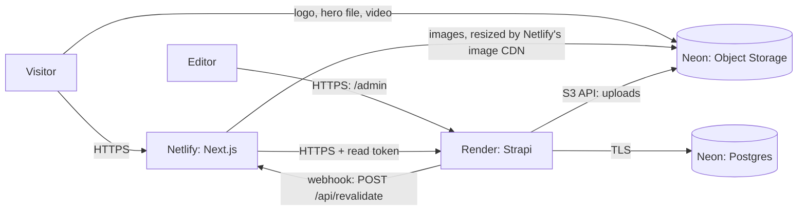

# Hosting on free plans: Netlify, Render and Neon

The portfolio deployment. The assignment itself ran on Railway (tag `v1.0.0`; see
[architecture → Railway](architecture.md#railway-configuration-as-code)).

| Piece | Service (free plan) | Config | Notes |
|---|---|---|---|
| Website (Next.js) | Netlify | [`netlify.toml`](../netlify.toml) | Serves cached pages; wakes the CMS during each build |
| CMS (Strapi) | Render | [`render.yaml`](../render.yaml) | 512 MB, sleeps after 15 min idle, up to a minute to wake |
| Database (Postgres) | Neon, Singapore | `DATABASE_URL` on Render | Render's own free Postgres expires after 30 days |
| Uploads | Neon Object Storage, same project | `S3_*` on Render | S3-compatible; Render's free disk is wiped on every restart |



**What changes from Railway:** there is no private network, so the website reaches Strapi over its
public HTTPS URL with the same read-only token, and the webhook calls the Netlify URL. Publishing
still refreshes the site on the next visit. Because pages read Strapi through the tagged cache, a
sleeping CMS only slows the first visit after a publish or a new deploy, not ordinary traffic.

## One-time setup

Order matters: the CMS needs the database and the bucket, the website needs tokens from the CMS, and
the bucket's CORS rule needs the website's URL.

1. **Neon database:** a project in AWS Singapore (`aws-ap-southeast-1`). Copy the **direct**
   connection string (the host without `-pooler`): Strapi's migrations need a session, not a
   transaction pool.
2. **Neon bucket**, in the same project and branch (*Object storage → New bucket*):
   - access level **`public_read`**: visitors' browsers load the files directly, and the level
     can't be changed after the bucket is created;
   - note the bucket's S3 endpoint and region (the console, or `GET /projects/{id}/branches/{id}/storage`
     in Neon's API). The files' public address, `S3_PUBLIC_URL`, is the endpoint followed by
     `/<bucket>`, since Neon only supports path-style URLs;
   - create a key pair with `neon credentials create --scope storage:read --scope storage:write`. The
     secret is shown once, so put it straight into a password manager or the env file below.
3. **Content and admin user, from your machine** (so no one can claim the admin on the live URL
   first). Put the values in `apps/cms/.env.neon` (git ignores `.env.*` files), one `NAME='value'` per
   line with single quotes (Neon's connection string contains `&`, which the shell would otherwise
   split on). Make sure `DATABASE_URL` is in it: otherwise the seed falls back to the local database
   in `apps/cms/.env`. Then in `apps/cms`:

   ```bash
   set -a; . ./.env.neon; set +a      # DATABASE_URL, DATABASE_SSL=true and the S3_* values
   export WEB_REVALIDATE_URL=          # empty: don't point the live webhook at localhost
   npm run seed                        # schema, all content, media into the bucket (~4 min)
   npx strapi admin:create-user --firstname=… --email=… --password=…
   ```

   The seed only adds what's missing, so it's safe to run again if it stops part way.
4. **Render:** *New → Blueprint*, pick this repository and the `portfolio/netlify` branch. Render
   reads `render.yaml`, generates Strapi's secrets and asks for the rest: `DATABASE_URL`, the six
   `S3_*` values, and a `REVALIDATE_SECRET`
   (`node -e "console.log(require('crypto').randomBytes(32).toString('hex'))"`). Set `PUBLIC_URL` to
   the service URL Render shows (e.g. `https://nota-cms.onrender.com`). Leave `CORS_ORIGINS` and
   `WEB_REVALIDATE_URL` empty until step 7.
5. **Tokens, in the live admin** (`/admin` → *Settings → API Tokens*, type Custom, duration
   Unlimited). They must be made there: tokens are hashed with the server's `API_TOKEN_SALT`.
   - read token: *find* on Global, Homepage and Product;
   - form token: *create* on Waitlist-signup, nothing else.
6. **Netlify:** *Add new project → Import from Git*, same repository, production branch
   `portfolio/netlify`. Netlify reads `netlify.toml`. Add these variables, then deploy:

   | Variable | Value |
   |---|---|
   | `STRAPI_INTERNAL_URL`, `STRAPI_PUBLIC_URL` | the Render URL |
   | `MEDIA_PUBLIC_URL` | the bucket's public address (the same value as `S3_PUBLIC_URL`) |
   | `STRAPI_READ_TOKEN`, `STRAPI_FORM_TOKEN` | from step 5 |
   | `REVALIDATE_SECRET` | the same value as on Render |
   | `SITE_URL` | the Netlify URL, e.g. `https://nota-rebuild.netlify.app` |

7. **Back on Render:** set `CORS_ORIGINS` to the Netlify URL and `WEB_REVALIDATE_URL` to
   `<Netlify URL>/api/revalidate`, then redeploy. The webhook appears under *Settings → Webhooks*.
8. **The bucket's CORS rule, from your machine.** A new Neon bucket lets any website read its files.
   This step limits reading to the site, now that its URL is known. In `apps/cms`:

   ```bash
   set -a; . ./.env.neon; set +a
   export CORS_ORIGINS='https://nota-rebuild.netlify.app,http://localhost:3000'   # your Netlify URL
   npm run storage:cors                # replaces the bucket's rules and prints the new one
   ```

   The site's origin must be in the rule: it loads the wordmark as a CSS mask and the hero file
   with `fetch()`, which browsers send in CORS mode, so a rule without it hides the wordmark and
   the hero animation. Include `http://localhost:3000` if you run the site locally against this
   bucket.

## Checks after the first deploy

- The site renders, and the response has `X-Robots-Tag: noindex`.
- Change a heading in the admin and publish: the next refresh shows it.
- Submit the order form: the entry appears under *Waitlist signup*; a repeat address shows success
  without a second entry.
- The header wordmark shows, the hero animation scrubs, and the console has no CSP or CORS errors.
  A missing wordmark means the bucket's CORS rule doesn't include the site's origin (step 8).

## Known limits of the free plans

- **Cold starts:** after 15 idle minutes the CMS sleeps. The admin takes up to a minute to open,
  and the first page view after a publish or deploy waits for it.
- **Memory:** Strapi runs in 512 MB. If a Render build fails for lack of memory, building the admin
  panel is the heavy step; a paid instance or building elsewhere are the ways out.
- **Database:** Neon's free plan is 1 GB and pauses after 5 idle minutes (resumes in about a second).
- **Storage:** 5 GB on the free plan, served from Singapore without a CDN. Netlify's image CDN
  resizes and caches the images, but videos, the logo and the hero file come straight from the
  bucket, so they load slower far from Singapore. Neon's suggested fix is a CDN in front of the
  bucket. Uploads carry a browser cache header (`config/plugins.ts`): fresh for a day, then
  rechecked in the background. It isn't `immutable` because replacing a file in the Media Library
  keeps its URL. SVGs are served from the storage domain, which holds no cookies or sessions.
- **Neon Object Storage is in beta.** The upload settings are plain S3, so moving to Cloudflare R2
  or AWS S3 means changing the `S3_*` values and copying the files.

## After the assignment round closes

Merge `portfolio/netlify` into `main`, switch the production branch on Render and Netlify to
`main`, then delete the Railway project.
