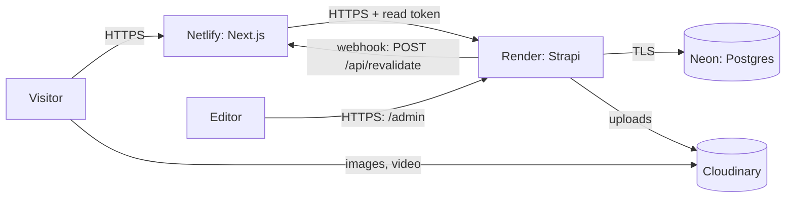

# Hosting on free plans: Netlify, Render, Neon and Cloudinary

The portfolio deployment. The assignment itself ran on Railway (tag `v1.0.0`; see
[architecture → Railway](architecture.md#railway-configuration-as-code)).

| Piece | Service (free plan) | Config | Notes |
|---|---|---|---|
| Website (Next.js) | Netlify | [`netlify.toml`](../netlify.toml) | Serves cached pages; wakes the CMS during each build |
| CMS (Strapi) | Render | [`render.yaml`](../render.yaml) | 512 MB, sleeps after 15 min idle, up to a minute to wake |
| Database (Postgres) | Neon, Singapore | `DATABASE_URL` on Render | Render's own free Postgres expires after 30 days |
| Uploads | Cloudinary | `CLOUDINARY_*` on Render | Render's free disk is wiped on every restart |



**What changes from Railway:** there is no private network, so the website reaches Strapi over its
public HTTPS URL with the same read-only token, and the webhook calls the Netlify URL. Publishing
still refreshes the site on the next visit. Because pages read Strapi through the tagged cache, a
sleeping CMS only slows the first visit after a publish or a new deploy, not ordinary traffic.

## One-time setup

Order matters: the CMS needs the database and Cloudinary, and the website needs tokens from the CMS.

1. **Neon:** create a project in AWS Singapore (`ap-southeast-1`). Copy the **direct** connection
   string (the host without `-pooler`): Strapi's migrations need a session, not a transaction pool.
2. **Cloudinary:** create an account and copy the cloud name, API key and API secret
   (*Settings → API Keys*).
3. **Admin user and content, from your machine** (so no one can claim the admin on the live URL
   first). In `apps/cms`, with the Neon and Cloudinary values:

   ```bash
   export DATABASE_URL='postgres://…neon.tech/neondb' DATABASE_SSL=true \
     CLOUDINARY_NAME=… CLOUDINARY_KEY=… CLOUDINARY_SECRET=… \
     WEB_REVALIDATE_URL=   # empty: don't point the live webhook at localhost
   npm run seed                                 # schema, all content, media to Cloudinary
   npx strapi admin:create-user --firstname=… --email=… --password=…
   ```

4. **Render:** *New → Blueprint*, pick this repository and the `portfolio/netlify` branch. Render
   reads `render.yaml`, generates Strapi's secrets and asks for the rest: `DATABASE_URL`, the three
   `CLOUDINARY_*` values, and a `REVALIDATE_SECRET`
   (`node -e "console.log(require('crypto').randomBytes(32).toString('hex'))"`). Set `PUBLIC_URL` to
   the service URL Render shows (e.g. `https://nota-cms.onrender.com`). Leave `CORS_ORIGINS` and
   `WEB_REVALIDATE_URL` empty until step 6.
5. **Tokens, in the live admin** (`/admin` → *Settings → API Tokens*, type Custom, duration
   Unlimited). They must be made there: tokens are hashed with the server's `API_TOKEN_SALT`.
   - read token: *find* on Global, Homepage and Product;
   - form token: *create* on Waitlist-signup, nothing else.
6. **Netlify:** *Add new project → Import from Git*, same repository, production branch
   `portfolio/netlify`. Netlify reads `netlify.toml`. Add these variables, then deploy:

   | Variable | Value |
   |---|---|
   | `STRAPI_INTERNAL_URL`, `STRAPI_PUBLIC_URL` | the Render URL |
   | `MEDIA_PUBLIC_URL` | `https://res.cloudinary.com/<cloud-name>` |
   | `STRAPI_READ_TOKEN`, `STRAPI_FORM_TOKEN` | from step 5 |
   | `REVALIDATE_SECRET` | the same value as on Render |
   | `SITE_URL` | the Netlify URL, e.g. `https://nota-rebuild.netlify.app` |

7. **Back on Render:** set `CORS_ORIGINS` to the Netlify URL and `WEB_REVALIDATE_URL` to
   `<Netlify URL>/api/revalidate`, then redeploy. The webhook appears under *Settings → Webhooks*.

## Checks after the first deploy

- The site renders, and the response has `X-Robots-Tag: noindex`.
- Change a heading in the admin and publish: the next refresh shows it.
- Submit the order form: the entry appears under *Waitlist signup*; a repeat address shows success
  without a second entry.
- Images, videos and the hero animation load from `res.cloudinary.com` with no CSP errors in the
  console.

## Known limits of the free plans

- **Cold starts:** after 15 idle minutes the CMS sleeps. The admin takes up to a minute to open,
  and the first page view after a publish or deploy waits for it.
- **Memory:** Strapi runs in 512 MB. If a Render build fails for lack of memory, building the admin
  panel is the heavy step; a paid instance or building elsewhere are the ways out.
- **Database:** Neon's free plan is 1 GB and pauses after 5 idle minutes (resumes in about a second).

## After the assignment round closes

Merge `portfolio/netlify` into `main`, switch the production branch on Render and Netlify to
`main`, then delete the Railway project.
